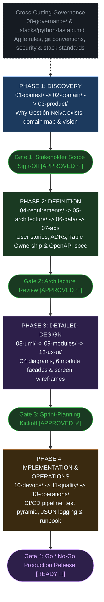

# SDD Guide — Software Design Documentation (Gestión Neiva)

## What is SDD?

**Software Design Documentation (SDD)** is an approach where architectural decisions,
domain boundaries, and technical contracts are specified and reviewed **before** code
implementation begins. Documentation is not a post-mortem record of what got built — it
is the plan the software build executes.

```
Traditional:  Code  ->  Documentation (if it ever happens)
SDD:          Documentation  ->  Code  ->  Updated documentation
```

### The 3 SDD principles

1. **Design before code:** A reviewed design document is the prerequisite for starting
   implementation. An unwritten decision has not been made yet.
2. **Living documentation:** Documents update in the exact same pull request as the code
   they describe. A document describing stale behavior is a bug.
3. **Traceability:** Every module change traces back to a user story (`HU-NN`), every
   requirement traces back to a business rule (`BR-NN`), and every rule has an automated test.

## The four phases and review gates



## Section index

| Section | Path | Purpose |
|---|---|---|
| `00` | [`00-governance/`](./00-governance/README.md) | How the team works, PR conventions, DoR, DoD, security policy |
| `01` | [`01-context/`](./01-context/README.md) | What we are building, for whom, scope In/Out, glossary |
| `02` | [`02-domain/`](./02-domain/README.md) | Bounded contexts, entities, business rules `BR-01` to `BR-12` |
| `03` | [`03-product/`](./03-product/README.md) | Problem framing for tenderos in Neiva and product vision |
| `04` | [`04-requirements/`](./04-requirements/README.md) | Backlog `HU-01` to `HU-12`, `NFR-01` to `NFR-10`, traceability |
| `05` | [`05-architecture/`](./05-architecture/README.md) | Modular monolith design, layered structure, ADRs 001 to 004 |
| `06` | [`06-data/`](./06-data/README.md) | Database conventions, Table Ownership, Alembic migrations 001-012 |
| `07` | [`07-api/`](./07-api/README.md) | REST conventions (`/api/v1`) and consolidated OpenAPI 3.0 spec |
| `08` | [`08-uml/`](./08-uml/README.md) | C4 Context, C4 Container, POS Checkout & Voice Turn sequences |
| `09` | [`09-modules/`](./09-modules/README.md) | The 6 module catalogs, facades, data models, and runbooks |
| `10` | [`10-devops/`](./10-devops/README.md) | Local setup (< 1h), environments matrix, GitHub Actions CI/CD |
| `11` | [`11-quality/`](./11-quality/README.md) | Test pyramid (`unit`, `module_integration`, `e2e`), TDD guide |
| `12` | [`12-ux-ui/`](./12-ux-ui/README.md) | Design system tokens (Tailwind v4), mobile touch, 5 screen specs |
| `13` | [`13-operations/`](./13-operations/README.md) | Structured JSON logging, health checks, backup and recovery SOPs |
| `_stacks` | [`_stacks/python-fastapi.md`](./_stacks/python-fastapi.md) | Official stack guide for Python 3.11+, FastAPI, and React 19 |

## The living-documentation rule

```
If code changed but the document did not  ->  the document is broken
If the document says X but the code does Y  ->  the document is a defect
```

Whoever opens a pull request changing application behavior must update the document
describing it in that exact same pull request.

---

**Related:** [`00-governance/README.md`](./00-governance/README.md) · [`00-governance/documentation-rules.md`](./00-governance/documentation-rules.md)
