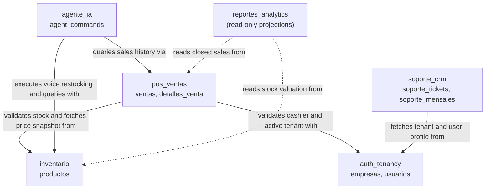

# 02 — Domain Map

## Bounded contexts

## Relationship legend

| Arrow | Meaning |
|---|---|
| `validates stock and fetches price snapshot` | In-process call to `InventarioFacade`. Checks availability and locks row with `FOR UPDATE`. Returns unit price snapshot |
| `validates cashier and active tenant` | In-process call to `AuthTenancyFacade`. Verifies user role and non-expired subscription |
| `executes voice restocking and queries` | In-process call to `InventarioFacade`. Mutates stock or performs catalog search from AI command |
| `queries sales history` | In-process call to `VentasFacade`. Reads sales volume or aggregates for AI queries |
| `fetches tenant and user profile` | In-process call to `AuthTenancyFacade`. Loads merchant identity for support ticket threads |
| `reads data (read projections)` | Analytical read queries for dashboard computation and Excel exports |

Every arrow is an in-process method call behind a facade. No database `FOREIGN KEY`
crosses between bounded contexts; references are stored as plain UUIDs.

---

**Related:** [`./entities-and-rules.md`](./entities-and-rules.md) · [`./module-boundaries.md`](./module-boundaries.md)
