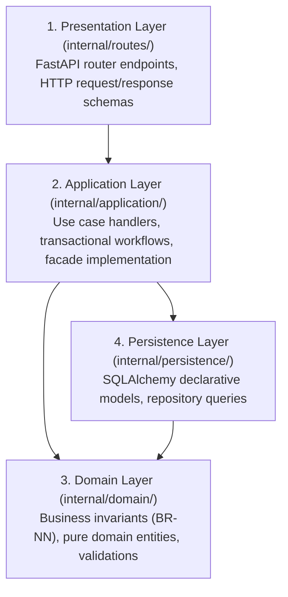

# 05 — Layered Architecture

## Internal layers per module

Each module in Gestión Neiva organizes its internal code across four distinct technical
layers to maintain strict separation of concerns and testability:

## Layer responsibilities

| Layer | Contains | Never contains |
|---|---|---|
| Presentation | FastAPI routers, parameter dependencies, HTTP status codes | Database queries, core business logic |
| Application | Use cases (e.g. `RegistrarVentaUseCase`), facade logic, transaction boundaries | Direct HTTP `Request`/`Response` objects |
| Domain | Pure domain models, invariant checks (e.g. `validar_stock_positivo`) | SQLAlchemy ORM bindings, database imports |
| Persistence | SQLAlchemy tables mapped to database columns, query helpers | HTTP framework imports, presentation formatting |

## Purity of business logic

Per **Constitution Article II**, the domain and application layers remain completely
decoupled from the FastAPI framework. Core calculations (subtotals, stock deductions,
trial expiration checks) run as pure Python functions without requiring web servers
or HTTP mocking in unit tests.

---

**Related:** [`./modular-monolith.md`](./modular-monolith.md) · [`./module-structure.md`](./module-structure.md)
