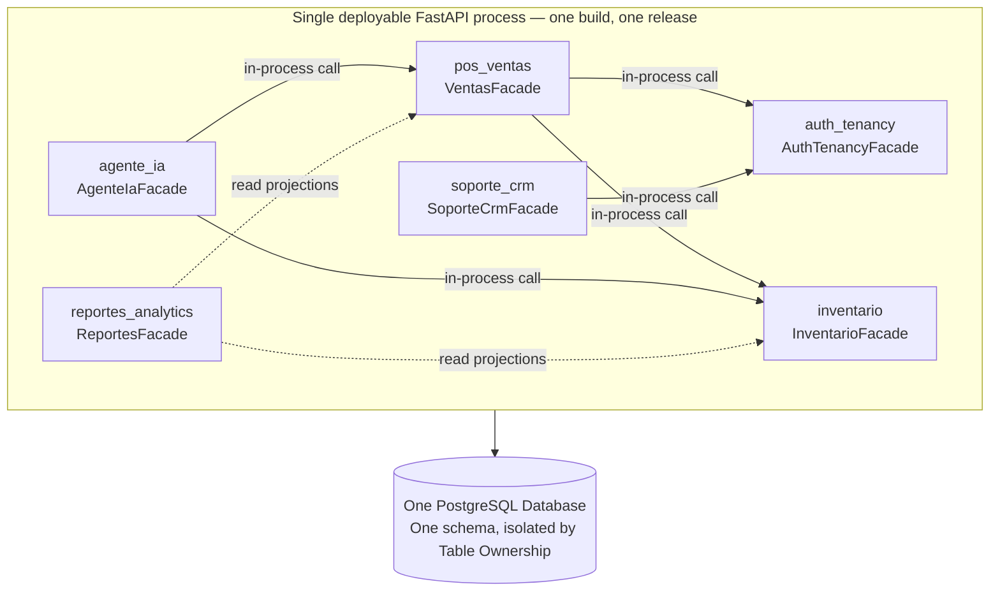

# 05 — Modular Monolith

## What it is

A **modular monolith** is one deployable application, built and released as a single unit,
divided internally into bounded contexts. Each module owns its tables, exposes a narrow
public API (`<Module>Facade`), and keeps everything else internal per **ADR-001**.

## One deployment, six modules

## Anatomy of a module

| Part | Rule |
|---|---|
| Public API | Single entry point `api/facade.py` — the only symbol external modules may import |
| Internal | Domain, application, and persistence code; strictly private to the module |
| Owned tables | Written by this module alone; external modules query data through the facade |
| Tests | `module_integration` tests exercise the public API; internals covered by `unit` tests |

## How modules interact

Calls between modules are plain in-process Python method invocations within the same
database session and transaction. There are no HTTP hops, message brokers, or network latency
between modules.

## Trade-offs

| Factor | Modular Monolith | Microservices Alternative |
|---|---|---|
| ACID POS Checkout | Guaranteed in one DB transaction with `with_for_update()` | Requires complex two-phase commit or sagas |
| Operational overhead | Low — single container image on Render/Docker | High — multiple services, networking, and CI pipelines |
| Refactoring cost | In-process symbol renames; static checks via linter | Network contract versioning and serialization breaking |

---

**Related:** [`../02-domain/module-boundaries.md`](../02-domain/module-boundaries.md) · [`./boundary-enforcement.md`](./boundary-enforcement.md)
