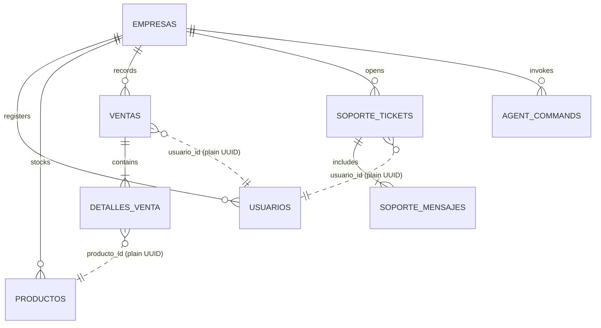

# 06 — Data Models

## Entities and Table Ownership

| Entity | Table | Owning module | Key attributes |
|---|---|---|---|
| Empresa | `empresas` | `auth_tenancy` | nombre_comercial, nit_o_cedula, plan, trial_expires_at |
| Usuario | `usuarios` | `auth_tenancy` | email, hashed_password, empresa_id (FK), rol, nombre, telefono_whatsapp |
| Producto | `productos` | `inventario` | empresa_id, codigo_barras, nombre, precio_costo, precio_venta, cantidad_actual, unidad_medida |
| Venta | `ventas` | `pos_ventas` | empresa_id, fecha_venta, total, usuario_id (UUID), vendedor_nombre_snapshot |
| DetalleVenta | `detalles_venta` | `pos_ventas` | venta_id (FK), producto_id (UUID), cantidad, precio_unitario, subtotal |
| SoporteTicket | `soporte_tickets` | `soporte_crm` | empresa_id, usuario_id (UUID), asunto, estado |
| SoporteMensaje | `soporte_mensajes` | `soporte_crm` | ticket_id (FK), remitente_rol, remitente_email, mensaje, created_at |
| AgentCommand | `agent_commands` | `agente_ia` | empresa_id, conversation_id, command_id, action, status, result |

*(All legacy ERP tables — `compras`, `cuentas_por_pagar`, `abonos`, `proveedores` — were permanently purged in migration 011).*

## Relationships

## Cross-module references

| Table | Column | Points to | Enforced by |
|---|---|---|---|
| `detalles_venta` | `producto_id` | `inventario.productos` | `InventarioFacade.validar_y_descontar_stock_atomic()` |
| `ventas` | `usuario_id` | `auth_tenancy.usuarios` | `AuthTenancyFacade.obtener_usuario()` |
| `soporte_tickets` | `usuario_id` | `auth_tenancy.usuarios` | `AuthTenancyFacade.obtener_usuario()` |

---

**Related:** [`./database-conventions.md`](./database-conventions.md) · [`./migrations.md`](./migrations.md)
