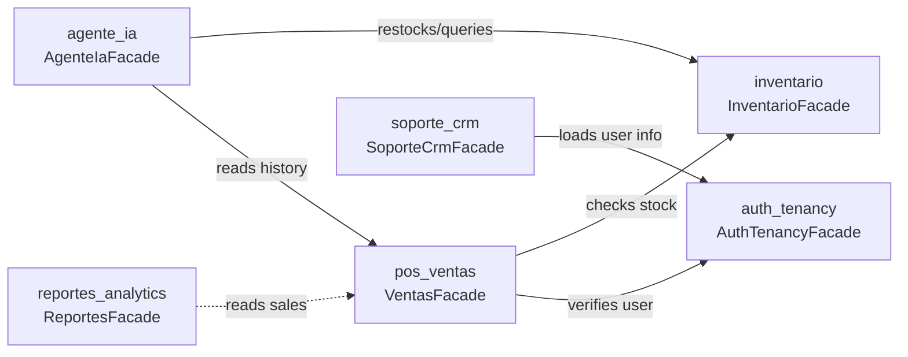

# 09 — Module Catalog

## Modules

| Module | Purpose | Owns | Public API | Status |
|---|---|---|---|---|
| `auth_tenancy` | Provision stores, authenticate users via JWT, manage plans & trials | `empresas`, `usuarios` | `AuthTenancyFacade` | Stable |
| `inventario` | Manage catalog items, barcodes, unit prices, and 15-day alerts | `productos` | `InventarioFacade` | Stable |
| `pos_ventas` | Execute atomic checkout, freeze price snapshots, and close registers | `ventas`, `detalles_venta` | `VentasFacade` | Stable |
| `soporte_crm` | Customer support helpdesk inbox and SuperAdmin store governance | `soporte_tickets`, `soporte_mensajes` | `SoporteCrmFacade` | Evolving |
| `agente_ia` | Voice audio transcription (Whisper), LLM intents, and idempotent commands | `agent_commands` | `AgenteIaFacade` | Evolving |
| `reportes_analytics` | Financial dashboard projections and Excel spreadsheet exports | *(none — read projections)* | `ReportesFacade` | Stable |

## Status legend

- **Stable:** Public API is locked; breaking changes require an accepted ADR.
- **Evolving:** Public API is actively adding capabilities across ongoing sprints.

## Dependencies between facades

---

**Related:** [`../02-domain/module-boundaries.md`](../02-domain/module-boundaries.md) · [`../05-architecture/modular-monolith.md`](../05-architecture/modular-monolith.md)
