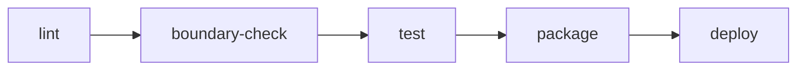

# 10 — CI/CD Pipeline

## One artifact, one pipeline

The application builds into one deployable artifact promoted forward across environments.
Module boundaries are verified statically before running tests.

## Stages

| Stage | Command | Purpose / Failure condition |
|---|---|---|
| `lint` | `ruff check app && python -m compileall -q app` | Catches syntax errors and style violations |
| `boundary-check` | `lint-imports` | Fails if any module imports private `internal/` code of another module |
| `test` | `pytest -m "unit or module_integration" --cov=app --cov-fail-under=80` | Fails if tests fail or coverage drops below 80% (90% on `pos_ventas`) |
| `package` | `docker build -t gestion-neiva-api:$(git rev-parse --short HEAD) .` | Builds the production container image |
| `deploy` | Automated Render & Vercel deployment hook | Deploys staging on merge to `dev`; production on release tag |

## Execution matrix

| Trigger | Executed stages | Target environment |
|---|---|---|
| Every Pull Request | `lint` ➔ `boundary-check` ➔ `test` ➔ `package` | Ephemeral build validation (no deployment) |
| Merge to `dev` | All 5 stages | `staging` (Render + Supabase Staging) |
| Release tag (`v*.*.*`) on `main` | All 5 stages | `production` (Render + Vercel + Supabase Prod) |

---

**Related:** [`./local-setup.md`](./local-setup.md) · [`../05-architecture/boundary-enforcement.md`](../05-architecture/boundary-enforcement.md)
