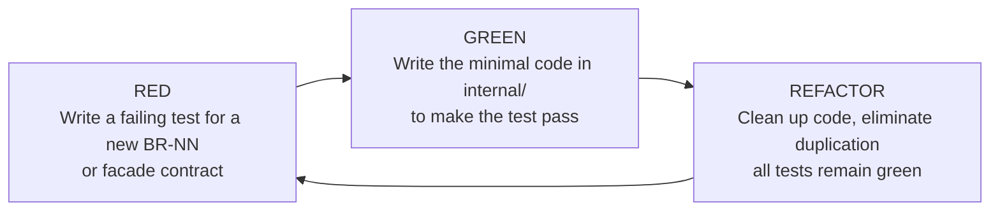

# 11 — TDD Guide

## Red, Green, Refactor

Every new capability or business rule (`BR-NN`) implemented in Gestión Neiva follows
the Test-Driven Development (TDD) cycle before code is merged:



## Practical TDD for Facades

1. **Write the contract first:** Define the request and response DTOs in `api/contracts.py`.
2. **Write the failing integration test:**
   ```python
   # tests/module_integration/test_ventas_facade.py
   def test_procesar_venta_when_stock_available_decrements_inventory(db_session):
       # Arrange stock = 10
       # Act: VentasFacade.procesar_venta(..., qty=2)
       # Assert: stock becomes 8, sale record exists
   ```
3. **Verify RED state:** Execute `pytest` and confirm it fails for the expected reason.
4. **Implement minimal logic:** Write the application use case and persistence code.
5. **Verify GREEN state:** Confirm tests pass with 100% assertions satisfied.
6. **Refactor:** Clean up internal structure; run `lint-imports` to verify no boundaries broke.

## Anti-patterns to reject in review

- **Test-after:** Writing tests after the feature is complete; fails to prove edge-case coverage.
- **Leaking internals in tests:** A test that imports `internal/persistence/models.py` of another module instead of using the public facade.

---

**Related:** [`./testing-strategy.md`](./testing-strategy.md) · [`../00-governance/definition-of-done.md`](../00-governance/definition-of-done.md)
