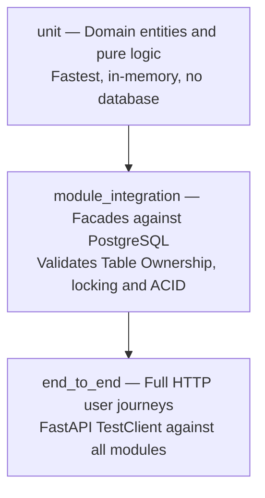

# 11 — Testing Strategy

## Test pyramid

## Layers and coverage targets

| Layer | Marker | Scope | Coverage target |
|---|---|---|---|
| `unit` | `@pytest.mark.unit` | Pure domain entities, calculations, FSM rules; no I/O | >= 80% on changed files |
| `module_integration` | `@pytest.mark.module_integration` | Public facades (`VentasFacade`, `InventarioFacade`) with real DB | >= 90% on `pos_ventas` (**NFR-07**) |
| `end_to_end` | `@pytest.mark.end_to_end` | Complete HTTP endpoint flows (`POST /api/v1/ventas`) | All ⭐-priority stories |

## Specialized test suites

- **Concurrency & Race Conditions:** `tests/test_concurrencia_real.py` launches concurrent threads attempting to buy the last inventory item, verifying that exactly one sale succeeds and all others return HTTP 422 per **BR-01** and **BR-04**.
- **Tenant Isolation (OWASP):** `tests/test_owasp_security.py` asserts that Store A credentials receive 404/403 when requesting Store B data per **BR-03** and **NFR-02**.
- **Performance & Stress:** `tests/stress/locustfile.py` measures p95 checkout latency under 50 concurrent transactions per **NFR-01**.

## Naming convention

Test names must state behavior: `<subject>_<condition>_<expectedResult>`  
Example: `test_checkout_whenStockInsufficient_raises422()`

---

**Related:** [`./tdd-guide.md`](./tdd-guide.md) · [`../04-requirements/traceability-matrix.md`](../04-requirements/traceability-matrix.md)
