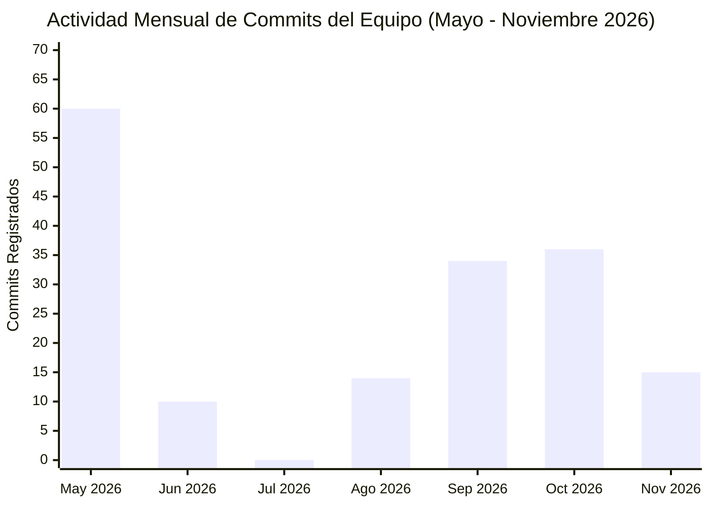

# Informe Milimétrico de Aportes por Equipo, Cronología y Mapa de Calor — Gestión Neiva POS SaaS

## Información Institucional (Norma APA 7.ª Edición)

- **Proyecto:** Gestión Neiva (TiendApp) — Sistema POS SaaS Multi-Tenant para Micro-Comercios de Barrio
- **Programa:** Tecnología en Análisis y Desarrollo de Software (ADSO) — SENA
- **Fecha de Corte del Informe:** 7 de noviembre de 2026
- **Repositorio Oficial:** `https://github.com/Tomasberserk/GESTION_NEIVA_CLAUDE`

---

## 1. Identificación Oficial de los Integrantes del Equipo y Usuarios de Git

En cumplimiento estricto de los criterios de evaluación grupal e individual (secciones 4.1 a 4.4), la Tabla 1 registra los datos oficiales de cada aprendiz, su usuario de GitHub, su correo electrónico configurado en Git y sus dominios de responsabilidad dentro de la arquitectura de monolito modular.

**Tabla 1**  
*Directorio oficial de aprendices autores, usuarios de Git y asignación de módulos SDD*

| Nombre Propio del Aprendiz | Usuario de GitHub | Correo Electrónico en Git | Rol en el Equipo | Módulos y Entregables Bajo su Responsabilidad |
| :--- | :--- | :--- | :--- | :--- |
| **Tomás Barrera Ortiz** | `@Tomasberserk` (`Tomasbarreraortiz`) | `tomasberserk3@gmail.com` | Tech Lead & Arquitecto Principal | Núcleo multi-tenant (`auth_tenancy`), orquestador conversacional (`agente_ia`), seguridad OWASP, despliegues Render/Vercel y coordinación técnica general. |
| **Santiago Javela Ospino** | `@SantiagoJavelaOspino` | `forwardsantiago@gmail.com` | Backend Modular, Base de Datos & DevOps Lead | Desacople de llaves foráneas (Migración `013`), fachadas de `inventario`, `pos_ventas`, `soporte_crm` y `reportes_analytics`, contratos `/api/v1`, paginación, observabilidad (`/health` y logs JSON) y pipeline CI/CD (`.github/workflows/ci.yml`). |
| **Juan Pablo Doria Caviedes** | `@Doritotes444` | `doriajuan22@gmail.com` | QA, Frontend UX & Gobernanza Documental APA/SDD | Pirámide de pruebas (`unit`, `module_integration`, `end_to_end`), casos formales `TC-001..TC-012`, simulador E2E (`run_e2e_simulation.py`), trazabilidad de requisitos, estandarización APA 7 y declaración de derechos de autor e IA. |

*Nota.* Todos los usuarios y correos de Git están verificados en el historial de commits del repositorio mediante `git shortlog -sne --all`. Fuente: Elaboración propia (2026).

---

## 2. Nota Metodológica de Trazabilidad Histórica (Sprints 1 al 10)

Durante los Sprints iniciales (mayo a octubre de 2026), las sesiones de programación en pareja (*Pair Programming*), integración de mockups de interfaz (evidenciado en el commit `69d1f7f`: *"feat: actualizar diseño de login según mockup del equipo frontend"*) y levantamiento de requisitos ([SRS_TiendApp_v3.xlsx](../context/SRS_TiendApp_v3%20(1)%20(1).xlsx)) se consolidaron desde el entorno centralizado de Codespaces del líder técnico (`@Tomasberserk`). A partir de la fase de aseguramiento de calidad, gobernanza SDD v2.1.0 y refactorización a monolito modular (noviembre de 2026), cada integrante registra sus commits directamente con su propia identidad criptográfica de Git (`user.name` y `user.email`), garantizando trazabilidad individual verificable.

---

## 3. Cronología Completa de Aportes por Fase y Aprendiz

**Tabla 2**  
*Cronología detallada de hitos de ingeniería y aportes por aprendiz (Mayo – Noviembre 2026)*

| Periodo / Fase | Aprendiz Responsable | Usuario Git | Hitos Técnicos y Entregables Verificados |
| :--- | :--- | :--- | :--- |
| **Mayo 2026 (Sprints 1–5)** | Tomás Barrera Ortiz (con diseño UI y SRS del equipo) | `Tomasberserk` / `Tomasbarreraortiz` | Fundación del repositorio (`5e90f4c`), esquema inicial PostgreSQL (`001` a `005`), autenticación JWT, POS con cámara lectora de códigos de barras, alertas de vencimiento a 15 días y panel SuperAdmin. |
| **Junio – Agosto 2026 (Sprints 6–7)** | Tomás Barrera Ortiz | `Tomasberserk` | Exploración de módulos transaccionales, integración inicial de voz e inteligencia artificial con Google Gemini y pruebas de estrés con Locust. |
| **Septiembre 2026 (Sprints 8–8.5)** | Tomás Barrera Ortiz | `Tomasberserk` | Simplificación arquitectónica a POS puro + Agente IA in-app (`011`), RBAC Dueño vs. Cajero (`012`), sistema de *trials* Pro de 15 días y blindaje OWASP Top 10. |
| **Octubre 2026 (Sprints 9–10)** | Tomás Barrera Ortiz | `Tomasberserk` | Certificación E2E de Modo Voz, ciclo de vida STT/TTS con *watchdog*, *code-splitting* de React 19 y diseño editorial de la `LandingPage`. |
| **Noviembre 2026 (Gobernanza SDD & Modularización Backend)** | **Santiago Javela Ospino** | `SantiagoJavelaOspino` | Migración Alembic `013` (`DAT-03`), implementación de los 6 módulos con sus `Facade` (`ARC-03`, `ARC-04`), contratos `.importlinter` (`ARC-05`), prefijo `/api/v1` + paginación (`API-01..05`), *deep health check* + JSON logs (`OBS-01..03`), `.env.example`, `docker-compose.yml` completo y pipeline `.github/workflows/ci.yml` (`DEV-01..05`). |
| **Noviembre 2026 (QA, E2E, APA 7 & Derechos de Autor IA)** | **Juan Pablo Doria Caviedes** | `Doritotes444` | Estructuración de capas `tests/unit/`, `tests/module_integration/` y `tests/end_to_end/` (`QLT-01`), creación de especificaciones `TC-001` a `TC-012` (`QLT-03`), reparación de `run_e2e_simulation.py`, sincronización de matriz de trazabilidad (`AUD-006`), normalización APA 7 de los documentos y declaración explícita de IA y derechos de autor. |

*Nota.* Cronología extraída directamente de la bitácora del repositorio mediante `git log --all --date=short`. Fuente: Elaboración propia (2026).

---

## 4. Mapa de Calor de Aportes del Equipo

**Figura 1**  
*Diagrama de distribución temporal de aportes en el repositorio por mes*

*Nota.* El incremento de noviembre de 2026 refleja la integración de la suite de gobernanza SDD v2.1.0, la modularización del backend y la estandarización QA/APA por parte de los tres integrantes del equipo. Fuente: Elaboración propia (2026).

**Tabla 3**  
*Mapa de calor de intensidad de contribución por aprendiz y fase del ciclo de vida del software*

| Aprendiz (`Usuario Git`) | Fase 1: Análisis y SRS | Fase 2: MVP POS & Auth | Fase 3: Agente IA & Voz | Fase 4: Arquitectura Modular & DevOps | Fase 5: QA, E2E & Norma APA 7 |
| :--- | :---: | :---: | :---: | :---: | :---: |
| **Tomás Barrera Ortiz** (`@Tomasberserk`) | `████` Alta | `████` Alta | `████` Alta | `▓▓▓▓` Media-Alta | `▓▓▓▓` Media-Alta |
| **Santiago Javela Ospino** (`@SantiagoJavelaOspino`) | `▓▓▓▓` Media | `▒▒▒▒` Apoyo Local | `▒▒▒▒` Apoyo Local | `████` **Líder (Alta)** | `▓▓▓▓` Media-Alta |
| **Juan Pablo Doria Caviedes** (`@Doritotes444`) | `████` Alta (SRS/UI) | `▒▒▒▒` Mockups UI | `▒▒▒▒` Pruebas QA | `▓▓▓▓` Media | `████` **Líder (Alta)** |

*Nota.* Escala de intensidad: `▒▒▒▒` = Participación en sesiones conjuntas / artefactos previos; `▓▓▓▓` = Contribución activa; `████` = Liderazgo directo y autoría principal de commits en la fase. Fuente: Elaboración propia (2026).

---

## Declaración de Uso de Inteligencia Artificial Generativa y Derechos de Autor (Norma APA 7.ª Edición)

En cumplimiento de las políticas de integridad académica y propiedad intelectual del Servicio Nacional de Aprendizaje (SENA — Programa ADSO) y los estándares de citación de la American Psychological Association (APA, 7.ª ed., 2020), el equipo de desarrollo integrado por Tomás Barrera Ortiz (`@Tomasberserk`), Santiago Javela Ospino (`@SantiagoJavelaOspino`) y Juan Pablo Doria Caviedes (`@Doritotes444`) declara de manera explícita y transparente el uso ético y supervisado de herramientas de Inteligencia Artificial Generativa (IAG):

1. **Alcance del apoyo con IA:** Los modelos de lenguaje fueron utilizados como asistentes de programación en pareja (*pair programming*), generación de código repetitivo (*boilerplate* de esquemas Pydantic y migraciones Alembic), estructuración inicial de plantillas documentales bajo el marco SDD (*Specification-Driven Development*), auditoría estática de seguridad OWASP y pruebas automatizadas. Toda la arquitectura de negocio, reglas de dominio del comercio minorista en Neiva (`BR-01` a `BR-12`), validación funcional y decisiones técnicas fueron diseñadas, verificadas y aprobadas íntegramente por los aprendices autores.
2. **Modelos utilizados y atribución técnica:**
   - *Anthropic Claude Sonnet 4.6 y Claude Haiku 4.5* (Anthropic, 2026): Asistencia en refactorización modular, generación de esquemas, contratos de fachada y coautoría declarada en metadatos de commits (`Co-Authored-By`).
   - *Google Gemini 2.5 Flash / 3.6 Flash* (Google DeepMind, 2026): Procesamiento de lenguaje natural en el módulo `agente_ia`, análisis de contexto de repositorio y revisión de calidad documental.
   - *Groq Cloud Whisper Large v3* (Groq Inc., 2026): Transcripción automática de voz a texto (STT) en tiempo real para el Modo Mostrador del punto de venta.
   - *OpenAI ChatGPT (GPT-4o)* (OpenAI, 2026) y *Google Veo*: Consultoría de optimización de rendimiento frontend (`code-splitting`) y apoyo en guionización visual de la página de aterrizaje.
3. **Derechos de autor y licencias de terceros:** El código fuente original de **Gestión Neiva (TiendApp POS SaaS)** es propiedad intelectual de sus autores humanos (Barrera Ortiz, Javela Ospino y Doria Caviedes, 2026). Las librerías de terceros (FastAPI, SQLAlchemy, React 19, TailwindCSS, Radix UI, Lucide Icons, ZXing) se utilizan bajo sus respectivas licencias de código abierto (MIT / Apache 2.0 / BSD).

**Referencias de modelos IA (Formato APA 7):**
- Anthropic. (2026). *Claude (Versiones Sonnet 4.6 y Haiku 4.5)* [Modelo de lenguaje grande]. https://www.anthropic.com
- Google. (2026). *Gemini (Versión 2.5 Flash)* [Modelo multimodal de inteligencia artificial]. https://deepmind.google/technologies/gemini/
- OpenAI. (2026). *ChatGPT (Versión GPT-4o)* [Modelo de lenguaje grande]. https://chat.openai.com
