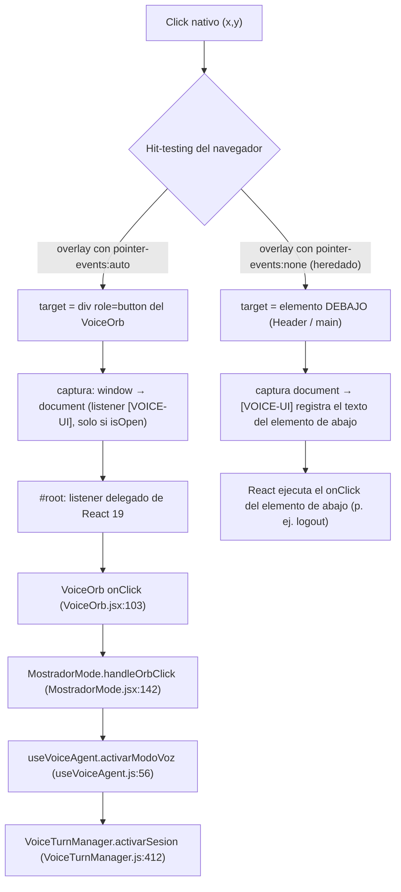

# Auditoría QA — Modo Voz: "botones muertos en producción"

**Commit auditado:** `cdde821` (HEAD, incluye `48b9c0c`) · **Alcance:** solo causas + fixes mínimos.

> [!IMPORTANT]
> **Veredicto:** se descarta la tesis de la extensión. La causa es del propio código y es **determinista**. Son dos defectos que se combinan y que entraron juntos con `48b9c0c`:
> 1. El overlay **hereda `pointer-events: none`** del `<aside>` del chat. Los clicks lo **atraviesan** y caen en el Header y el Dashboard que están debajo.
> 2. Al quitar el early-return (fix de Rules of Hooks), **el JSX del overlay quedó sin condición**: se pinta siempre, aunque `isOpen === false`.

---

## 1. Cadena del click (orbe → manager) y puntos de corte



| # | Punto de corte | ¿Existe en el código? | Evidencia |
|---|---|---|---|
| P1 | **Hit-testing: `pointer-events: none` heredado** | **SÍ: corta siempre** | `AgentWidget.jsx:189` pone `pointer-events-none` en el `<aside>` cuando `!chatAbierto`. `AgentContext.jsx:78`: `abrirModoVoz` hace `setChatAbierto(false)`, así que **con el modo voz abierto el aside siempre es `pointer-events:none`**. El overlay (`MostradorMode.jsx:164`) no lo sobreescribe. El `<section>` del chat sí lo hace (`AgentWidget.jsx:194`, `pointer-events-auto`), lo que muestra que el patrón se conocía pero se olvidó en el overlay. |
| P2 | Overlay invisible con z-index mayor | No en reposo | `CartSidebar` (z-40/z-30, con translate fuera de pantalla) y los modales z-50 solo cubren cuando están abiertos. Ojo: el `z-[70]` del overlay **no sirve**, porque vive dentro del contexto de apilamiento del `<aside>` `fixed z-30`. Su z efectivo es 30, y cualquier `z-40`/`z-50` raíz (CartSidebar, ModalUpsell, Sidebar móvil `Sidebar.jsx:56`) se pinta encima. |
| P3 | `stopPropagation`/`stopImmediatePropagation` del proyecto | Solo en el botón de emergencia (`MostradorMode.jsx:93`, fase target, no afecta al resto) y en `ModalUpsellPro.jsx:67` (burbuja, local) | grep en `src/` |
| P4 | Listener de extensión en captura de `window`/`document` | No verificable en el repo. Ver §6 (refutada) | — |
| P5 | Service worker | No existe | grep `serviceWorker` vacío |

---

## 2. Por qué `[VOICE-UI]` aparece "a veces"

El listener solo se registra si `isOpen` (`MostradorMode.jsx:54`). En cambio, el overlay se pinta **siempre** (`MostradorMode.jsx:160`, sin condición desde `48b9c0c`). De ahí salen dos estados que se ven iguales en pantalla:

| Estado | ¿Overlay visible? | ¿`[VOICE-UI]` registrado? | ¿Botón `#voice-emergency-exit`? | Qué pasa con el click |
|---|---|---|---|---|
| **A**: recién logueado, o tras Escape / Salir / `cerrarModoVoz` (`modoVozAbierto=false`) | **Sí** (sin condición) | **No → no hay log** | **No** | Atraviesa el overlay hacia Header/Dashboard |
| **B**: el usuario "tocó" sin saberlo el botón **Voz** del Header que está *debajo* del overlay (`Header.jsx:84`) → `isOpen=true` | Sí | **Sí → hay log** | Sí | Atraviesa igual. **El log muestra el texto del elemento de abajo** (p. ej. `"Voz"`, `"Caja / Mostrador"`, texto de una tarjeta del Dashboard), no `"Salir"` ni `"Reiniciar"` |

> [!TIP]
> Señal diagnóstica clave: revisa el `label` de las líneas `[VOICE-UI]` que ya tienes. Si nunca dice `Salir`, `Reiniciar` ni `Toca para Iniciar Escucha`, P1 queda confirmado.

BFCache no interviene: un login nuevo no es una restauración, y si lo fuera aparecería `[APP-LIFECYCLE]` de `main.jsx:16` seguido de una recarga.

---

## 3. Ciclo mount → unmount → remount

La secuencia `init IDLE → desmontaje → detenerSesion → READY → IDLE` es exactamente lo que imprime el cleanup de `useVoiceAgent.js:45-53`. `detenerSesion()` llama a `_invalidateCurrentTurn()`, que emite **READY** (`VoiceTurnManager.js:115`), y después emite **IDLE** (`:699`).

| Candidato | Veredicto | Evidencia |
|---|---|---|
| **Click que atraviesa hasta el "Salir" (logout) del Header** | **Causa principal en prod.** El "Salir" del overlay (arriba a la derecha, `MostradorMode.jsx:200`) cae sobre el "Salir" de logout del Header (arriba a la derecha, `Header.jsx:152-159`, `h-14`). `logout` → `usuario=null` → `ProtectedRoute` → `<Navigate to="/login">` → **Layout se desmonta** → cleanup. Al volver a loguearse, se remonta y el overlay reaparece. | P1 + `ProtectedRoute.jsx` |
| StrictMode (solo dev / localhost) | Da la **misma** secuencia de logs (`main.jsx:22`). En un build de Vercel no hay doble montaje. Si el log viene de localhost, es ruido esperado. | `main.jsx:22` |
| `ProtectedRoute` `cargando` | Descartado: `cargando` solo es `true` en el primer montaje. AuthContext **no** vuelve a pedir `/me` (efecto `[]`). | `AuthContext.jsx:10-25` |
| AgentWidget / `<aside>` | Descartado: siempre se renderiza y no hay `key` ni render condicional. | `AgentWidget.jsx:189` |
| Navegación / Suspense lazy | Descartado: `Layout` es una ruta padre compartida. RR v7 envuelve las navegaciones en `startTransition`, así que no hay fallback que desmonte. | `App.jsx`, `package.json` (`react-router-dom ^7`) |
| 401 → `window.location.href` | Recarga dura, no es un "unmount". Se vería la URL `/login?expirado=1`. | `authService.js:93-97` |

---

## 4. Apertura "espontánea"

- `setModoVozAbierto(true)` **solo** se alcanza desde `abrirModoVoz` (`AgentContext.jsx:77`), que se invoca únicamente en `AgentWidget.jsx:215` y `Header.jsx:84`. No hay efectos que lo abran. ✅ Confirmado.
- **Pero no hace falta abrirlo**: el overlay se ve sin `isOpen` (defecto §2, estado A). El "me manda para la orbe" justo después del login es **determinista**, no un click accidental en el FAB. El FAB del chat no es la causa. Además, para llegar a `AgentWidget.jsx:215` hay que abrir antes el chat, que son dos clicks deliberados.

---

## 5. Paracaídas existentes

| Paracaídas | ¿Falla? | Por qué | Mejora mínima |
|---|---|---|---|
| Cable de emergencia (`MostradorMode.jsx:68-104`) | **Parcial** | (a) Solo existe con `isOpen`, y en el estado A (el normal tras login) **no aparece**. (b) `remove()` manual de un nodo que maneja React: en el siguiente unmount (logout) React hace `removeChild` sobre un nodo ausente → `NotFoundError` → todo el árbol se cae (no hay ErrorBoundary). (c) Si ya estás en `/dashboard` no recarga, y el modo voz queda sin nodo hasta F5. (d) **No** sobrevive a una extensión que corte en la captura de `document`, porque sus listeners están en fase target, *después* de esa captura (lo que dice el commit `cdde821` es incorrecto). | No quitar nodos de React. Si el puente de React no cerró el overlay en ~300 ms, hacer `location.replace` siempre (diff F4). |
| Teclado Escape/Enter (`:113-140`) | **Sí, en apariencia** | Escape → `onClose()` pone `isOpen=false`, pero el overlay **sigue visible** (§2). Enter sí funciona (es teclado, sin hit-testing), y eso explica que "a veces el teclado sí sirve". | Se arregla con F1, sin tocar este bloque. |
| `pageshow` + `persisted` (`main.jsx:14-19`) | No falla | Correcto, aunque no tiene relación con este síntoma. | Ninguna. |

---

## 6. Tesis a falsificar: "una extensión llama a `stopImmediatePropagation()` en la captura de `document`"

**Refutada por el código** (falta confirmarla con la prueba R3):
1. React 19 delega en `#root`, que va *después* de `document` en la fase de captura. Si la extensión cortara ahí, **morirían todos los clicks de la app** (login, Sidebar, Header). El usuario sí pudo loguearse y navegar.
2. El patrón intermitente de `[VOICE-UI]` coincide exactamente con `isOpen` (§2), no con un filtro externo.
3. `200.js` y `M_ID`: no aparecen en `frontend/src`, `public`, `index.html` ni `dist` (grep vacío). El CSS del proyecto se sirve como `assets/index-*.css`, no como un recurso llamado `css`. `css:2:1 ERR_SOCKET_NOT_CONNECTED` y `TypeError 'M_ID'` vienen de una extensión. **Es ruido y no tiene relación.**

---

## 7. Tabla de hallazgos

| # | Causa | Evidencia | Prob. | Fix mínimo |
|---|---|---|---|---|
| H1 | El overlay hereda `pointer-events:none` y los clicks lo atraviesan | `AgentWidget.jsx:189`, `AgentContext.jsx:78`, `MostradorMode.jsx:164` | **Alta** | F2 (portal) |
| H2 | El overlay se renderiza sin condición tras `48b9c0c` | `MostradorMode.jsx:160` (sin `if (!isOpen) return null`) | **Alta** | F1 |
| H3 | El click que atraviesa el "Salir" del overlay dispara el logout del Header → ciclo de unmount | `MostradorMode.jsx:200` sobre `Header.jsx:152` | **Alta** (consecuencia de H1) | F2 |
| H4 | `z-[70]` no funciona: el overlay queda atrapado en el contexto de apilamiento z-30 del `<aside>` | `AgentWidget.jsx:189` `fixed z-30` | Media | F2 (el portal lo resuelve) |
| H5 | El cable de emergencia quita un nodo de React → posible crash `removeChild`. No existe en el estado A. | `MostradorMode.jsx:75-76` | Media | F4 |
| H6 | El E2E no reproduce el hit-testing real (click por JS, `force`, o `dispatchEvent`). No hay test de voz en el repo (`run_e2e_simulation.py` no hace clicks). | grep | Media | F5 |
| H7 | Extensión (200.js) | §6 | **Baja** (refutada) | Ninguno |

### Diffs sugeridos

**F1 — condición *después* de todos los hooks (legal según las Rules of Hooks)** · `MostradorMode.jsx`
```diff
   const handleOrbClick = () => {
     ...
   }

+  // Todos los hooks ya corrieron arriba: este retorno es legal (Rules of Hooks).
+  if (!isOpen) return null
+
   return (
     <div
```

**F2 — sacar el overlay del `<aside>` con un portal** (resuelve H1, H3 y H4 a la vez) · `MostradorMode.jsx`
```diff
 import React, { useEffect } from 'react'
+import { createPortal } from 'react-dom'
 ...
-  return (
-    <div
+  return createPortal(
+    <div
       tabIndex={-1}
       data-voice-overlay="1"
-      className="fixed inset-0 z-[70] bg-slate-950 ...
+      className="pointer-events-auto fixed inset-0 z-[70] bg-slate-950 ...
     >
       ...
-    </div>
-  )
+    </div>,
+    document.body
+  )
```
*(Alternativa mínima sin portal: añadir solo `pointer-events-auto`. Eso arregla H1/H3 pero no H4.)*

**F4 — el cable de emergencia no toca el DOM de React** · `MostradorMode.jsx:70-78`
```diff
     const salir = () => {
       try { window.__voiceSalirAlDashboard?.() } catch { /* React muerto */ }
-      try {
-        document.querySelectorAll('[data-voice-overlay="1"]').forEach((n) => n.remove())
-        if (!location.pathname.startsWith('/dashboard')) location.assign('/dashboard')
-      } catch { /* no-op */ }
+      // Si React no desmontó el overlay en 300 ms, recarga dura (nunca quitar nodos de React a mano)
+      setTimeout(() => {
+        if (document.querySelector('[data-voice-overlay="1"]')) location.replace('/dashboard')
+      }, 300)
     }
```

**F3 (diagnóstico, opcional) — logger que dice dónde cayó el click** · `MostradorMode.jsx:56-57`
```diff
-      console.log(`[VOICE-UI] click capturado en fase-documento: "${label}" (voiceState=${voiceState})`)
+      const enOverlay = !!e.target?.closest?.('[data-voice-overlay]')
+      console.log(`[VOICE-UI] click "${label}" ${enOverlay ? 'EN overlay' : 'FUERA (atravesó)'} (voiceState=${voiceState})`)
```

**F5 — E2E realista:** usar `locator.click()` **sin** `force` (o `page.mouse.click(x,y)`). Añadir dos aserciones: `expect(page.locator('[data-voice-overlay]')).toHaveCount(0)` justo después del login, y que tras pulsar "Salir" del overlay la URL **no** sea `/login`.

---

## 8. Ranking final y prueba de < 60 s para cada causa

### 🥇 1. H1: los clicks atraviesan el overlay (`pointer-events:none` heredado)
1. Con el overlay en pantalla, pasa el ratón sobre **Salir** o **Reiniciar**. Si **no cambia el fondo al hacer hover** (`hover:bg-slate-700`) ni aparece el cursor de mano, se confirma.
2. En la consola de DevTools:
   ```js
   getComputedStyle(document.querySelector('[data-voice-overlay]')).pointerEvents   // "none" ⇒ CONFIRMADO
   document.elementFromPoint(innerWidth/2, innerHeight/2).closest('[data-voice-overlay]') // null ⇒ CONFIRMADO
   ```
3. Click en "Salir" del overlay. Si terminas en `/login`, H3 queda confirmado.

### 🥈 2. H2: el overlay se pinta sin `isOpen`
1. Pestaña nueva → login → **no toques nada**.
2. Si el overlay ya está visible, en la consola:
   ```js
   !!document.getElementById('voice-emergency-exit')   // false ⇒ isOpen=false con overlay visible ⇒ CONFIRMADO
   ```
3. Haz click en cualquier parte: **no** debe salir ningún `[VOICE-UI]`, lo que confirma el estado A de §2.

### 🥉 3. H7: extensión que traga los clicks (tesis, se espera refutarla)
1. Abre una ventana **de incógnito** (Ctrl+Shift+N; las extensiones vienen desactivadas por defecto) → misma URL de Vercel → login.
2. Si el overlay aparece igual y los botones siguen muertos (repite las pruebas 1 y 2), **la tesis queda REFUTADA**. Los errores `200.js`/`M_ID`/`css:2:1` desaparecerán de la consola, porque son ruido de la extensión.
3. Solo si en incógnito todo funciona y en la ventana normal no, habría que reabrir la tesis. Por el código (§6) eso es muy improbable.

> [!NOTE]
> Los fixes de `48b9c0c` (Rules of Hooks, `salirAlDashboard` sin logout, `z-[70]`) siguen siendo correctos en su lógica, pero **ningún click llega a ellos**. El "Salir que deslogueaba" no era el handler: era el click que atravesaba el overlay hasta el logout del Header. Con F1 + F2 se cierra todo.
